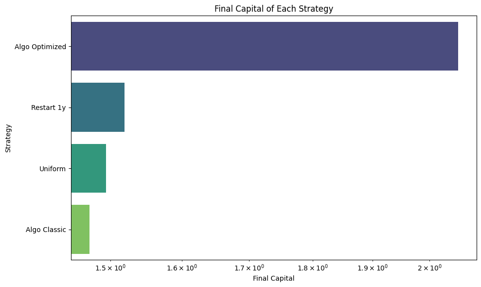

# Online portfolio selection: Universal Portfolio and VB-FTRL with regime restarts

CentraleSupélec research project (Pôle MICS, Jan–Jun 2025), supervised by Damien Challet.
Full report: [`report/Projet_S8_Apprentissage_en_Ligne.pdf`](report/Projet_S8_Apprentissage_en_Ligne.pdf).

## Question
Online portfolio selection rebalances a portfolio every day with no model of returns, and is judged by *regret*
against the best constant-rebalanced portfolio (BCRP) chosen in hindsight. Cover's Universal Portfolio (UP) has
optimal regret but is intractable beyond a few assets; VB-FTRL-qN (volumetric-barrier FTRL with quasi-Newton steps)
approximates it at polynomial cost. Both minimise *cumulative* regret, so once converged they react slowly to a change
of market regime. We test whether a rank-correlation restart rule fixes this.

## Contents
| Path | What it does |
|---|---|
| `universal_portfolio/universal_portfolio_opti.ipynb` | UP by Monte Carlo over the simplex; vectorised NumPy version and GPU versions (CuPy, PyTorch test) |
| `vb_ftrl_restart/VB_FTRL_qn_Restart.py` | VB-FTRL-qN with restart when the rank correlation of consecutive daily returns falls below a threshold |
| `vb_ftrl_restart/VB_FTRL.py` | Same, with restart driven by a pluggable asset-scoring function (`scoring.py`: mean return, compounded return, Sharpe) |
| `vb_ftrl_restart/Blest.py`, `aggresive_tau.py` | Rank-correlation measures: Blest's coefficient, top-weighted Kendall's tau |
| `vb_ftrl_restart/Final.ipynb` | Main study: restart criterion, choice of correlation metric, tuning of mu, lambda and threshold, COVID-period example |
| `vb_ftrl_restart/sp500_subpanels.ipynb` | Robustness runs on random 10-asset panels drawn from S&P 500 constituents |
| `vb_ftrl_restart/price.py` | Synthetic return generator (stochastic volatility) |
| `archive/s7_first_iteration/` | First-semester prototypes (synthetic and real-data tests) |

## Method
1. **Universal Portfolio.** Wealth-weighted average of all constant-rebalanced portfolios, estimated by sampling the
   simplex; the loop over portfolios and days is replaced by matrix operations (cumulative products, rolling windows,
   stable softmax) and moved to GPU.
2. **VB-FTRL-qN.** FTRL with log-loss plus a volumetric barrier (`mu`) and a bias towards the uniform portfolio
   (`lambda`), solved with `S` quasi-Newton steps in an affine parametrisation of the simplex.
3. **Restart rule.** At each date, rank assets by return (or by a score), compare the ranking with the previous
   date's using Kendall's tau, weighted Kendall's tau or Blest's coefficient, and restart the learner from the uniform
   portfolio when the correlation falls below a threshold. The rule uses information up to the current date only.

## Results
Comparison with and without restart, Kendall criterion:



Other criteria and weight trajectories: `vb_ftrl_restart/figures/`.

## Limitations
- No transaction costs: restarts and daily rebalancing are free here, which favours active strategies.
- Universe is current S&P 500 constituents: survivorship bias.
- `mu`, `lambda` and the restart threshold are tuned on the same period they are evaluated on: results are in-sample.
- BCRP is a hindsight benchmark, not a tradable strategy.

## Data
Prices are not committed. Ticker lists are in `vb_ftrl_restart/data/`; rebuild the files with
```
pip install -r requirements.txt
python scripts/fetch_data.py
```
`sp500_subpanels.ipynb` imports a helper module `run_vb_ftrl_qn` that was not recovered from the project archive.

## Credits
The baseline Universal Portfolio implementation is adapted from
[andrewcharlesjones/universal_portfolios](https://github.com/andrewcharlesjones/universal_portfolios) (credited in the notebook).

Team (S8): Nabil El Yazidi, Victor Letournel, Javier Toro Berrios, Philémon Webbe, Seif Zaafouri.
First-iteration work (S6–S7, `archive/`): Vinicius Da Mata e Mota, Quentin Fretault, Nicolas Lafaille, Martin Pupat, Zein Sakkour, Philémon Webbe.
